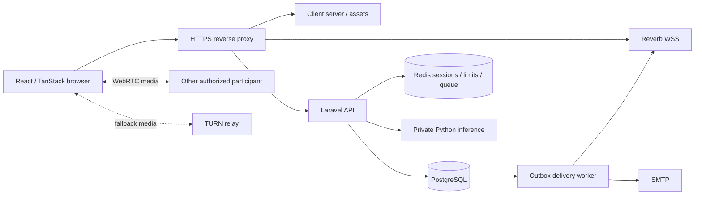

# Proposed Laravel 13 architecture

Implementation note (2026-10-28): the approved application path is `server/`, not the earlier proposed `api/` sibling. The retired Bun code was moved to ignored `_server/`; there is no legacy data or password import. Local development uses SQLite, PHP 8.4+, native Laravel hashing, and Predis when Redis is configured. The user will choose and configure PostgreSQL or MySQL later. These confirmed decisions override conflicting proposal text below.

## Objective and boundaries

Deliver the existing telehealth workflows through one Laravel API and one internal Python inference service. Keep React/TanStack. Use a normal Laravel application, not a custom module framework, repository layer, generic CRUD engine, or extra backend services. The module specs are ownership boundaries within this application.

PHP 8.4 is the proposed runtime; Laravel 13 requires at least 8.3. Lock Composer dependencies, JS dependencies, Python dependencies, model revisions, and system-image versions. Pin Laravel `^13.0`, resolve a compatible patched release, commit `composer.lock`, and verify the resolved version before implementation. See [release notes](https://laravel.com/framework/docs/13.x/releases).

## Topology



Only the reverse proxy exposes public API/WSS endpoints. Python has no browser-facing endpoint and no application database credentials. Laravel owns identity, permissions, appointments, clinical records, audit, notifications, and error translation. Python owns decoding, ASR, alignment, and scoring. Do not add the Laravel AI SDK merely because speech analysis exists.

Laravel now lives in `server/`; the retired Bun runtime is not part of the active workspace. Development ports are client 3000, Laravel 8080, Python 8001, and Reverb 8081 when installed; production TLS terminates at the proxy. Production URLs and database infrastructure remain deployment inputs.

## Conventional application structure

```text
server/
  app/Enums/                    backed role, status and event enums
  app/Models/                   Eloquent models and relationships
  app/Http/Controllers/Api/V1/   thin JSON controllers
  app/Http/Controllers/Auth/     session lifecycle controllers
  app/Http/Requests/             validation and authorization
  app/Http/Resources/            explicit public representations
  app/Http/Middleware/           active/verified account enforcement
  app/Policies/                 record ownership and role permissions
  app/Actions/                   multi-record operations only
  app/Services/PhonemeClient.php one concrete Python integration
  app/Jobs/                     outbox delivery and maintenance
  app/Events/                   server-authorized broadcasts
  app/Notifications/            mail delivery where appropriate
  app/Console/Commands/          import and reconciliation commands
  bootstrap/app.php             routes, middleware, exception JSON setup
  config/                       environment-backed configuration
  database/{migrations,factories,seeders}/
  routes/{api,web,channels,console}.php
  tests/{Feature,Unit}/
```

Middleware and exceptions are configured in `bootstrap/app.php`; do not generate an old-style HTTP Kernel as the application entry point. API routes come from `php artisan install:api`. Broadcasting setup comes from `php artisan install:broadcasting`. Preserve the standard `AppServiceProvider`; add a provider only when needed. Follow [Laravel's directory conventions](https://laravel.com/framework/docs/13.x/structure) and [routing setup](https://laravel.com/framework/docs/13.x/routing).

Use plural snake_case tables, snake_case attributes, singular PascalCase models, foreign keys with matching string types, UTC timestamps, explicit casts via `casts()`, validated input, explicit API Resources, factories, and feature tests. Existing IDs are mixed arbitrary strings, UUIDs, and CUIDs: import them without conversion into `varchar(191)` keys; foreign keys use the identical type. Do not apply `foreignId()` or UUID validation to legacy user IDs. New records may use UUID strings without rewriting existing IDs. No credentials in model serialization.

Example of the intended style, not runnable code in the current repository:

```php
public function store(StoreSoapRequest $request, User $patient): SoapResource
{
    $this->authorize('createForPatient', [Soap::class, $patient]);

    $soap = $patient->patientSoaps()->create([
        ...$request->validated(),
        'clinician_id' => $request->user()->getKey(),
    ]);

    return new SoapResource($soap);
}
```

Controllers using `$this->authorize()` must include Laravel's `AuthorizesRequests` trait in their base controller; otherwise use `Gate::authorize()`. Multi-record clinical writes use an Action and transaction rather than this minimal single-record example.

## Authentication and authorization

Use Sanctum's first-party session-cookie mode, not localStorage bearer tokens. Prefer same-origin proxying. For subdomains configure stateful domains (including development ports), cookie domain, exact CORS origins, credentials, Axios `withCredentials`/`withXSRFToken`, and headers. Unrelated SPA/API domains do not satisfy the documented Sanctum SPA topology. See [Sanctum](https://laravel.com/framework/docs/13.x/sanctum).

Bootstrap CSRF with `GET /sanctum/csrf-cookie`, then login through session middleware. Regenerate the session ID on login. On logout invalidate the session and regenerate the CSRF token. Retain Laravel 13's request-forgery protections and token fallback; never exempt the entire API to make the SPA work. The current 419 interceptor simply repeats the failed request; replace it with one CSRF refresh and one retry, and test real middleware/browser behavior. See [Laravel 13 CSRF](https://laravel.com/framework/docs/13.x/csrf).

`auth:sanctum` establishes identity. Add active-account and verified-email checks to protected business routes. Policies then enforce role AND relationship; binding a model by ID does not authorize access. Administrators manage accounts/content/reports but have no default right to clinical notes, encounters, recordings, or session rooms. Avoid a global superadmin policy bypass. See [authorization](https://laravel.com/framework/docs/13.x/authorization).

Roles retain `superadmin`, `admin`, `clinician`, `patient`. Accounts retain `pending`, `active`, `suspended`. Status is authoritative; map legacy `banned`, reason, and expiry explicitly during import. Role/status changes revoke sessions and realtime access. Privileged account creation is an administrator workflow; making another administrator is proposed to require superadmin. Confirm this intentional restriction of current behavior.

## API and write conventions

New business routes use `/api/v1`; session routes use `/login`, `/logout` with the `web` stack. Use Form Requests, route model binding plus policies, enums, transactions, eager loading, and explicit Resources. Unknown or inaccessible clinical records return 404 consistently. Nonclinical forbidden actions return 403. Invalid input returns 422; state conflicts return 409. Do not translate arbitrary exceptions into client-visible database messages. [Validation](https://laravel.com/framework/docs/13.x/validation), [Resources](https://laravel.com/framework/docs/13.x/eloquent-resources).

Mutations derive actor IDs from the session. Use validated allowlists, not `$request->all()`. Paginate with integer `page >= 1`, `1 <= per_page <= 100`, default 15, stable ID tie-breaks, allowlisted sort keys, and explicit filter arrays. UTC ISO-8601 output; date-only filters require a documented timezone and use half-open ranges. Do not silently reinterpret legacy timestamps without profiling.

Booking and appointment transitions lock slot first, appointment second; all paths use this order. Serialize competing schedule writes through the clinician row before checking interval overlaps. PostgreSQL constraints backstop statuses, positive durations, unique references, and at most one active appointment per slot. Test races on PostgreSQL, not only SQLite. [Transactions](https://laravel.com/framework/docs/13.x/database).

Write audit rows and durable notification intents in the same domain transaction. An `outbox_messages` row has ID, kind, aggregate/event ID, recipient ID, minimal payload, available/claimed/delivered timestamps, attempt count, and a unique delivery key. A worker claims with an expiring lease, retries failures, and uses recipient/event uniqueness to prevent duplicate inbox rows. Queue dispatch after commit improves ordering, but a scanner must recover committed intents if dispatch fails. Avoid retaining clinical text in outbox payloads. Activation/recovery mail has one explicit exception: any code/link needed for delivery is encrypted at rest in a purpose-bound expiring mail envelope, never plaintext, purged on delivery/expiry and excluded from telemetry and failed-job dumps. The challenge store retains only the verification digest. See [queue commit behavior](https://laravel.com/framework/docs/13.x/queues).

## Operational and privacy requirements

- Use Redis-backed sessions, rate limits, queues, and realtime coordination across web workers. Use database constraints for data invariants, not Redis locks alone.
- Configure trusted proxies explicitly; never trust arbitrary client forwarding headers for rate-limit identity. Scope login/OTP limits by normalized account plus trusted client address; bound inference separately by user and service concurrency.
- TLS, explicit allowed origins, `APP_DEBUG=false`, secret injection, backup encryption, restore rehearsal, process supervision, and private service networking are release requirements.
- Health endpoints expose liveness separately from readiness. Python readiness verifies warmed models and decoder; Laravel readiness verifies essential dependencies without returning secrets. Do not run costly inference in every health probe.
- Log request IDs, route/status, elapsed time, event IDs, queue attempts, and inference durations. Exclude session cookies, OTPs, passwords, audio, transcripts, SOAP bodies, and referral URLs from telemetry.
- No recording, assessment-history table, stored chat, or new external analytics is introduced by default. Ephemeral audio is deleted on success, rejection, timeout, and failure. Explicitly approve retention and access before adding persistence.
- User deactivation preserves clinical and audit records. No cascading hard-delete of users, appointments, notes, or audit evidence. Retention/deletion policy must identify jurisdiction, minors/guardian handling, lawful purpose, expiry, backups, and who approves erasure; this document does not choose legal periods.

## Commands and verification

Commands from `server/`: `composer install`, `php artisan migrate`, `php artisan serve --port=8080`, `php artisan test`, `vendor/bin/pint --test`, `php artisan route:list --path=api`, `composer audit`. Queue/Reverb/scheduler processes are introduced with the modules that need them and must be supervised in production.

Client commands from `client/`: `bun run test`, `bun run build`, `bun run lint`, `bunx tsc --noEmit`. Python's proposed check is `python -m pytest -q`; add a pinned test dependency and tests first. Exact production Python runtime and compatibility pins must come from the feasibility task, not an unverified latest install.

Every module inherits these commands, directory conventions, data/security rules, and boundaries. Use focused `php artisan test --filter=<ModuleName>` during slices, then the full suite at checkpoints. Required suites: policy denial matrix, state transitions, race conditions, contract fixtures, import reconciliation, real browser CSRF/realtime, and bounded Python failure paths. No arbitrary line-coverage percentage substitutes for these scenarios.

Always validate trust boundaries and test forbidden access. Obtain product decisions before changing clinical workflows, credential recovery strategy, data retention, or discarding legacy rows. Never use destructive reset commands on source data, suppress failing checks, or mark clinical inference validated without evidence.

## Decisions to confirm

| ID  | Proposed default / unresolved question                                                                                                                                         | Gate              |
| --- | ------------------------------------------------------------------------------------------------------------------------------------------------------------------------------ | ----------------- |
| D1  | PostgreSQL production; Redis coordination. Confirm hosting support and backups.                                                                                                | platform          |
| D2  | Same-origin SPA/API proxy; confirm public URLs, SSR deployment and cookies.                                                                                                    | identity          |
| D3  | Is there real legacy data? Confirm source snapshot and write-freeze window.                                                                                                    | import/cutover    |
| D4  | Prove Bun hash compatibility; otherwise forced password reset. No plaintext conversion.                                                                                        | identity import   |
| D5  | Superadmin creates administrators; admin creates clinicians; prevent privileged peer escalation.                                                                               | user-admin        |
| D6  | Clinicians read records only for established care relationships; author-only SOAP edits; no blanket admin access. Confirm team sharing and patient visibility.                 | clinical-records  |
| D7  | Preserve current pending-only cancellation, 24-hour cutoff, and blocked cancellation slots initially. Accepted cancellation, unblocking, rescheduling need explicit decisions. | appointments      |
| D8  | No persisted audio/chat/assessment results. Confirm clinical retention, consent and minors policy; don't infer consent for old records.                                        | production        |
| D9  | Reject ambiguous legacy timezone data; choose scheduling timezone and daylight-saving behavior.                                                                                | scheduling/import |
| D10 | English/en-US inference scope only. Validate model input/scoring semantics, redistribution/deployment license, and clinician-reviewed calibration.                             | phoneme release   |
| D11 | Proposed inference cap: 10 MiB, 60 seconds decoded audio, 800 reference characters, one concurrent inference per worker. Confirm against real hardware.                        | phoneme release   |
| D12 | Session entry initially requires ACCEPTED and a current participant; define any extra early/late join window before adding it.                                                 | realtime          |

A blocked decision stops only its dependent implementation. This review package is complete without pretending those product/deployment decisions have already been made.
D1 - Use predis, use sqlite for local dev (i will setup the postgresql/mysql database myself later)
D2- decide for local development
D3 - no
D4 - ditch bun. use laravel hashing
D5 - Superadmin can create all users, admin creates clinicians, prevent privileged peer escalation
D6- confirmed. approved.
D7- Confirmed. approved.
D8 - confirmed. approved.
D9 - confirmed. approved.
D10 - Confirmed. approved. Mark this for future improvements: other language support
D11 - confirmed. approved.
D12 - can join early or late. session room shall be deleted 5 minutes after the time end window.
