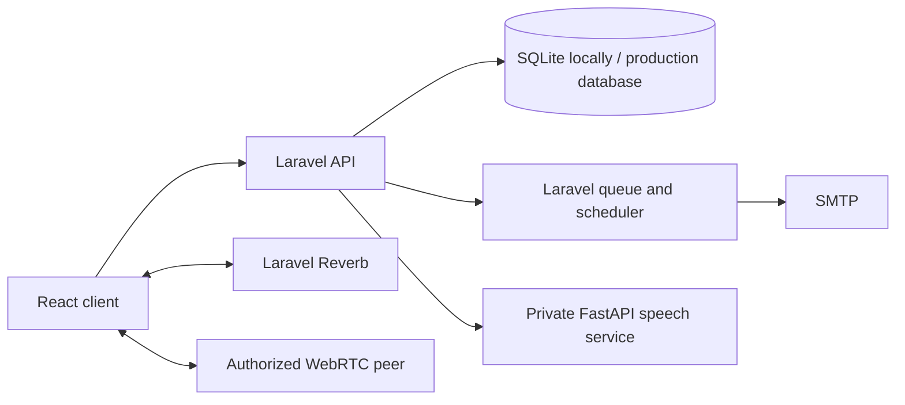

# Current architecture

TalkTherapy uses a React client, Laravel API, Reverb transport, and private Python speech service.

## Topology



| Concern                   | Rule                                                                             |
| ------------------------- | -------------------------------------------------------------------------------- |
| Browser to Python         | Prohibited; Laravel is the only speech boundary.                                 |
| Laravel                   | Owns identity, authorization, business rules, persistence, and public contracts. |
| Reverb                    | Authorizes private user and appointment channels.                                |
| WebRTC                    | Carries media directly or through configured TURN infrastructure.                |
| Production infrastructure | Database, Redis, proxy, and TURN remain deployment inputs.                       |

## Source layout

| Path                       | Responsibility                              |
| -------------------------- | ------------------------------------------- |
| `client/src/routes/`       | URL definitions and route adapters          |
| `client/src/modules/`      | Feature APIs, hooks, types, and components  |
| `client/src/components/`   | Reusable presentation components            |
| `client/src/integrations/` | Query and transport integration             |
| `server/app/Http/`         | Controllers, requests, and Resources        |
| `server/app/Policies/`     | Relationship and role authorization         |
| `server/app/Actions/`      | Transactional multi-record operations       |
| `server/app/Jobs/`         | Outbox delivery and recovery                |
| `server/database/`         | Migrations, factories, and seeders          |
| `server/tests/`            | Feature and unit coverage                   |
| `py/src/phoneme_service/`  | Private decoding, ASR, and assessment logic |

## Data and security

| Area             | Requirement                                                           |
| ---------------- | --------------------------------------------------------------------- |
| Tests            | Use isolated SQLite databases.                                        |
| Production       | Use a supported relational database and Redis coordination.           |
| Sessions         | Use Sanctum first-party cookies.                                      |
| Protected routes | Require active, verified accounts.                                    |
| Policies         | Enforce role and relationship for sensitive resources.                |
| Audit and outbox | Commit with the domain transaction.                                   |
| Payloads         | Exclude clinical text, transcripts, audio, and credentials.           |
| Speech           | Remains bounded, private, non-diagnostic, and clinically unvalidated. |

## Client loading

| Stage          | Behavior                                               |
| -------------- | ------------------------------------------------------ |
| Parent guard   | Authenticates in a browser-only `beforeLoad`.          |
| Child route    | Inherits typed QueryClient and session context.        |
| Critical route | Preloads the shared query options.                     |
| Component      | Subscribes to the same options through Query hooks.    |
| Freshness      | Query resource stale times control cache reuse.        |
| Session        | Reuses results for thirty seconds before revalidation. |

## Verification

```sh
# client
npm run lint
npx tsc --noEmit
npm test
npm run build

# server
php artisan test --compact
php vendor/bin/pint --test
composer validate --strict
composer audit --locked

# Python
python -m pytest -q
python -m ruff check src tests
python -m compileall -q src tests
```

SQLite cannot prove PostgreSQL locking, Redis coordination, browser cookies, TURN connectivity, or multi-instance revocation.

## Release gates

| Gate       | Evidence                                                                        |
| ---------- | ------------------------------------------------------------------------------- |
| Browser    | Authentication, CSRF, and critical workflows pass.                              |
| Database   | PostgreSQL races and production indexes are verified.                           |
| Realtime   | Reconnect, revocation, TURN, and media cleanup are verified.                    |
| Speech     | Dependencies, model artifacts, and system packages are locked.                  |
| Operations | Backup, restore, rollback, monitoring, and secret rotation are rehearsed.       |
| Governance | Privacy, licensing, and clinical review approve retained speech data or scores. |
